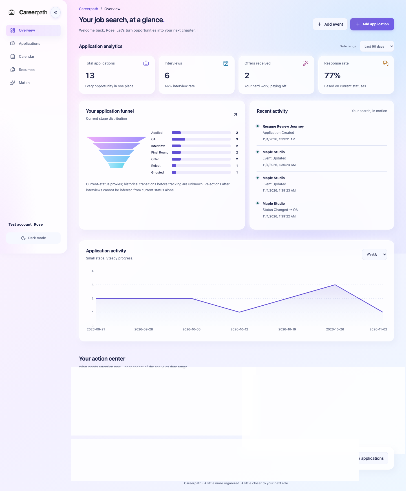
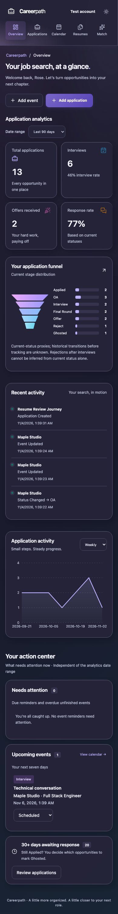
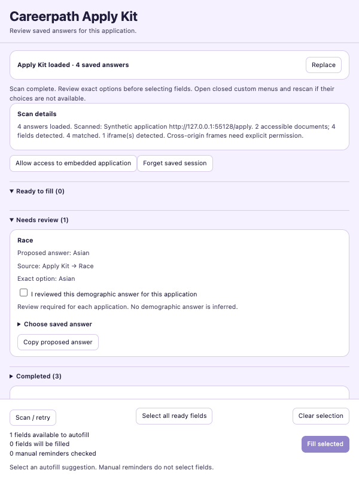
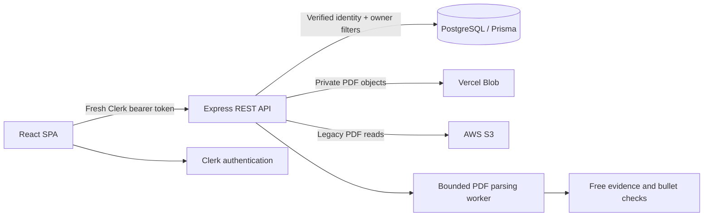

# Interview Tracker · Careerpath

A full-stack job-search workspace for organizing applications, preparing for interviews, and understanding recruiting progress. Built with React, TypeScript, Express, PostgreSQL, Prisma, Clerk and private Vercel Blob storage.

## Screenshots

The current workspace shown with synthetic browser-test data.





## Features

- **Workspace:** soft pink, lavender and blue gradients in light mode, with a dark theme and responsive layouts. On desktop, the collapse button sits beside the Careerpath logo, the account button sits at the bottom of the sidebar, and a transparent Careerpath breadcrumb replaces the top banner. Navigation and Match history can collapse independently.
- **Overview:** total applications, interviews, offers and response rate appear first. The application funnel sits beside recent activity on desktop, with weekly/monthly trends and the action center below. The interview count and rate use current application stages. Totals, offers and funnel stages open filtered applications while preserving the analytics date range. Reminders and manual 30-day review stay independent of that range.
- **Email updates:** manually sync recruiting emails labeled Careerpath in Gmail, review suggested matches and link messages to applications. Use the connected-account filter guide to copy an exact-sender or sender-plus-recruiting-phrases search and create the Careerpath label filter yourself in Gmail. Read-only permissions and manual sync remain unchanged. See [Gmail setup](docs/GMAIL.md).
- **Apply Kit:** save private application details and reusable answers across devices, search by topic or answer, and copy individual responses. Starter questions cover software engineering and mentoring, and you can add your own. Use the [free local Chrome side-panel extension](extensions/apply-kit/README.md) to preview saved answers, select fields to fill, and verify retained values beside an employer’s form.
- **Applications:** create, edit, detail and delete; company/role search; location/status/date filters; sorting; 10 rows per page; notes, salary, HTTP(S) job links, resume selection and event scheduling; quick status updates, removable filter chips and reset filters. Search remains synchronized with browser history.
- **CSV:** transactional imports of up to 500 rows and filtered exports of up to 10,000 rows; invalid batches fail without partial imports; formula-leading export cells are escaped.
- **Resume library:** named PDFs, 4 MB upload limit, private S3/Blob storage, one-minute downloads and ownership checks. Each resume opens a job-specific review with an optional extracted-text preview. Legacy object keys remain unchanged.
- **Resume match:** free rule-based reviews from an uploaded PDF or pasted text; editable keyword/manual checklists, common aliases, exact evidence excerpts, conditional bullet-editing prompts and printable saved reports. Optionally link to an application and reuse its job description. No AI-provider calls, fabricated achievements, ATS scores or hiring predictions. See [review workflow](docs/RESUME_REVIEW.md).
- **Calendar:** OA, Interview and Other events, with optional application links; timed events in the viewer's local zone and all-day deadlines that keep their saved date; editing, rescheduling, completion and cancellation through one shared form.
- **Dashboard reminders:** one day, one hour, 15 minutes or None. Upcoming events cover seven days; Needs attention includes due reminders and overdue unfinished events regardless of analytics dates. No delivery service or worker is needed; open the app to see reminders.
- **30-day review:** select eligible Applied applications manually, ten per page. The server rechecks ownership, age and current status before marking selected records Ghosted and recording activity.
- **UI:** reusable dialogs, native focus handling, labeled inputs, responsive navigation, light/dark mode, toast feedback, skeletons, actionable empty/error states and delete confirmation.

## Apply Kit autofill

The Chrome extension runs locally with rule-based matching. It needs no paid AI, extra hosting, AWS service or Chrome Web Store listing. Careerpath stores your saved Apply Kit answers in its existing owner-scoped database; the extension receives only the export you choose to paste.

1. Open `chrome://extensions` in **Chrome 116+**, enable **Developer mode**, choose **Load unpacked**, and select `extensions/apply-kit`. For an existing installation, click **Reload** after updating the files.
2. In Careerpath’s **Apply Kit**, save your answers and click **Copy autofill data**. On the employer tab, click the extension icon → **Open side panel**, then paste the export. Resize the panel with Chrome’s divider.
3. Click **Scan / retry**. Review the application question, proposed answer, saved-answer source and exact choice. Scan, selection counts and fill controls remain visible while results scroll.
4. Select individual fields or **Select all ready fields**, then **Fill selected**. Review the read-back results. Existing values and manually edited fields are preserved; rescan after navigation or form changes.
5. Upload your résumé and submit directly on the employer’s form. Only after an employer receipt or confirmation, use the panel’s application-record section to hand company, role, location, date and original job URL to Careerpath’s duplicate-check/add/edit flow. Review and save the record there.

| Group | What it means |
| --- | --- |
| **Ready to fill** | A clear saved-answer match, with a unique matching option for choice controls. Bulk selection includes only these fields. |
| **Needs review** | Missing or ambiguous answers, demographics, eligibility, consent/conflict questions, unsupported controls or failed writes. Demographic suggestions require individual approval for each application. |
| **Completed** | The value was read back and validated during the last scan or fill. Rescan after editing the employer form. |

Text fields, native selects, radio/checkbox groups and accessible custom dropdowns/autocomplete are supported when their questions, options and selection state can be verified. Scan may briefly open empty custom menus to inspect choices; it does not select an option. Typing into autocomplete alone does not count as completion. Phone dialing code, residence country, state and postal code are matched separately.

Permitted iframe documents can be scanned, including accessible Greenhouse and Ashby embeds. Cross-origin embeds require the panel’s explicit **Allow access to embedded application** grant. Browser restrictions, inaccessible option lists and controls without a reliable commitment signal still need manual entry. This is not a claim of universal ATS compatibility.

Use **Retry this field** when a menu did not expose its choices. General availability dates are kept separate from parsed employment dates. GPA values can map to explicit brackets, while **Application-only answer / option** supports one-off employer choices and translated labels without changing saved answers. Narrower demographic identities and missing graduation dates are never inferred. Eightfold choices require a committed-selection check after blur. Open the panel on the LinkedIn job page before following Apply to retain an observed original link; otherwise paste that link manually.

Manual reminders stay separate from autofill selections. The panel reports a résumé filename and native validation state when available; a selected file does not prove the employer accepted the upload. Confirm its preview or receipt and check for upload errors on the employer form.

Answers and per-tab/page progress remain in Chrome’s session storage across panel closes and page switches. Use **Forget saved session** to clear them; they are not synced or saved in extension local storage. Optional site-access grants persist until removed in Chrome. Only explicitly approved answers are written to an employer page. The extension never clicks Submit. Duplicate checks use the exact original URL, so URL variants may need manual review.



The side-panel screenshot shows the v2.2 isolated Chrome preview using synthetic data. See the [extension guide](extensions/apply-kit/README.md) for setup and [provider verification notes](extensions/apply-kit/VERIFICATION.md) for live-inspection evidence and manual limitations. The metadata handoff needs the updated Careerpath frontend; reloading the extension does not deploy the app.

### Apply Kit recovery and receipt evidence (v2.2)

Scans now expose per-document progress with two concurrent workers, a 10-second document budget and a 30-second overall budget. Partial successful results survive failures. Run-scoped cancellation and bounded field retries prevent stale scans from replacing current work. Open shadow roots and newly loaded forms are discoverable; inaccessible frames, closed roots and native-accessibility-only controls remain manual. Detected Greenhouse/Ashby application URLs can open in a standalone tab while retaining the observed original job link.

Topic sections organize the three status groups. Passwords and legal acknowledgments stay outside autofill. Native dates use ISO values; segmented/custom dates remain manual. Graduation seasons require the employer’s explicit month definition and matching year plus individual review. Structured employment fragments are flagged for review without rewriting résumé data.

Submission state is independent of filled fields. After an actual employer receipt, the extension can hand a short confirmed excerpt, source and time to Careerpath. The add/edit form requires confirmation again. The API validates ownership, saves evidence transactionally in the activity timeline and deduplicates evidence within an application; an owned email reference is also supported. No new database table is needed. A Submit click, disabled button or vanishing form is never sufficient proof.

The v2.2 checks cover lint, types, builds, unit/component tests, disposable-database integration, browser journeys and the isolated unpacked extension. The [synthetic preview source](extensions/apply-kit/fixtures/recovery.html) is exercised by the extension journey. This verifies local behavior, not universal live ATS compatibility or hosted deployment. See [verification details](extensions/apply-kit/VERIFICATION.md).

## Storage cutover

New uploads default to private Vercel Blob; missing configuration fails explicitly. For temporary local/pre-cutover S3 uploads, set `RESUME_STORAGE_PROVIDER=s3`. Existing S3 records remain readable. The manual, dry-run-first migration command and current inventory are documented in [resume storage migration](docs/RESUME_STORAGE_MIGRATION.md); never run apply during a build or deployment.

## Stack and architecture

React 19 + Vite + TypeScript, React Router, TanStack Query, Axios, Tailwind CSS 4, Recharts and Lucide. Express 5 + TypeScript, Zod, Prisma 5 + PostgreSQL, Clerk, AWS SDK v3 S3/SES, and retained legacy reminder history. Vitest, Testing Library, Supertest, Playwright and GitHub Actions cover quality checks.



`client/src/pages` owns page workflows, `components` owns reusable views/forms, `hooks/useApi` retrieves a fresh Clerk token for each request, and TanStack Query caches data under keys containing the user ID. Pages are loaded on demand and chart/auth dependencies are separate production chunks.

`server/src/routes` handles HTTP boundaries, `services` owns application transactions and matching, `controllers` implements dashboard/storage operations, `lib` owns validation/errors, and `jobs` contains reminder delivery. `createApp` is separate from the server listener for integration testing. Test authentication injection is rejected outside `NODE_ENV=test`.

### Database relationships

| Model          | Purpose                                                                                                                                  |
| -------------- | ---------------------------------------------------------------------------------------------------------------------------------------- |
| ApplyKitEntry  | Owner-scoped saved prompt/answer, optional stable starter key, category and revision for stale-edit checks |
| User           | Clerk ID as primary key; optional legacy email retained                                                                                  |
| JobApplication | Owner, opportunity details, current status, optional resume and retained legacy follow-up date                                           |
| Resume         | Owner, preserved S3 object key/legacy URL, name, description, version and optional file metadata                                         |
| Activity       | Structured kind and JSON transition metadata tied to an application                                                                      |
| Interview      | Owner-scoped calendar events; optional application, category, all-day flag, UTC instant, IANA zone, notes/status and dashboard lead time |
| Reminder       | Durable due time, unique dedupe key, attempts, lease, delivery state and receipt                                                         |
| Analysis       | Owner, optional resume/application, job snapshot, status/failure reason, versioned result and creation date                              |

Owner/date and owner/status indexes support scoped lists. Application deletion cascades dependent timeline/rounds/reminders. Resume deletion clears application selection and deletes associated analyses. The migration adds tables/nullable columns/defaults without deleting existing records or object keys.

The dashboard returns `upcoming`, `upcomingCount`, `attention`, `attentionCount` and `ghostCount`, independent of analytics date filters. Event lists are date-bounded and paginated. Existing interview routes remain compatibility adapters for linked Interview events. Follow-up fields and delivery history remain stored for rollback; new writes ignore legacy follow-up dates and create no delivery jobs. See [calendar rollout and preview](docs/CALENDAR.md).

## Local setup

Use Node.js **22.13+** (Node 22 LTS recommended), npm and PostgreSQL 16+. A Clerk development application is required for interactive sign-in. Private storage is needed only for PDF workflows; pasted-text reviews require no storage or AI provider. Legacy email remains disabled by default.

```sh
npm ci
cp server/.env.example server/.env
cp client/.env.example client/.env
npm run db:generate
```

Populate the files locally. Never paste secret keys in chat or commit them. The old tracked frontend `.env` is removed from version control by this upgrade; use the example file. Rotate any previously exposed AWS/Clerk credentials through their dashboards.

| Variable                                  | Purpose                                                                           |
| ----------------------------------------- | --------------------------------------------------------------------------------- |
| DATABASE_URL                              | PostgreSQL connection URL; use TLS for a managed database                         |
| PORT                                      | API port, default 5001                                                            |
| CLIENT_ORIGIN                             | Exact frontend origin; HTTPS required in production                               |
| CLERK_PUBLISHABLE_KEY / CLERK_SECRET_KEY  | Backend Clerk configuration                                                       |
| VITE_CLERK_PUBLISHABLE_KEY                | Public frontend Clerk key for the same instance                                   |
| VITE_API_URL                              | API base URL including `/api`; compiled into the frontend build                   |
| AWS_REGION / AWS_BUCKET_NAME              | Private resume bucket configuration                                               |
| AWS_ACCESS_KEY_ID / AWS_SECRET_ACCESS_KEY | Optional local standard SDK credentials; prefer a workload IAM role in production |
| AWS_ACCESS_KEY / AWS_SECRET_KEY           | Legacy S3-only aliases retained for compatibility                                 |
| EMAIL_PROVIDER                            | `console` (default) or `ses`                                                      |
| EMAIL_FROM                                | Required verified sender for SES                                                  |

For a **new, empty database only**, apply the migration chain:

```sh
npm run db:migrate
```

For an existing database, follow [the migration runbook](docs/DEPLOYMENT.md#existing-database-upgrade) first. Do not run reset, force-push or replay unapplied historical migrations against existing resume data.

Start the frontend/API:

```sh
npm run dev
```

Open `http://localhost:5173`. API liveness is `http://localhost:5001/health`; `/ready` checks the database. Dashboard cards refresh every minute and when relevant data changes. Dashboard reminders require opening the app; no worker is needed.

### External services

**Clerk:** configure the development frontend origin/redirects and matching publishable/secret keys. The API verifies session tokens with an authorized-origin allowlist before every `/api` route. No custom JWT secret is used.

**S3:** enable Block Public Access and default encryption. Give the API role only `s3:PutObject`, `s3:GetObject`, and `s3:DeleteObject` for the configured bucket's resume objects, including legacy keys. Do not rename legacy objects. Bucket permissions are an external setup step; deploying code alone does not make old public objects private. Existing objects must be audited before enabling a production demo. See [privacy and storage operations](docs/SECURITY.md).

**Resume reviews:** free checks run in the backend. Legacy AI configuration is ignored; no provider key or consent checkbox is required. PDF extraction is bounded to 20 pages / 40,000 characters with an explicit limit warning. Pasted text is not stored in full; job descriptions, report excerpts and guidance remain in private history. Completed/processing reviews count toward the rolling daily allowance; failed attempts do not. This is evidence matching and editing guidance, not semantic AI analysis.

**SES:** verify a sender/domain, configure the worker's IAM role with `ses:SendEmail`, and verify recipients while SES is in sandbox. Console mode stays functional without SES. No live email or paid model requests are part of the automated tests.

## API conventions

Bearer authentication is required for `/api/*`. Errors use `{message, errors?: [{field,message}]}` with appropriate HTTP status; successful creates use 201 and deletes 204. List responses use `{items,total,page,pageSize,totalPages}` for applications. Maximum page size is 100. Resume lists show at most 200 versions, interview lists at most 500 rounds, analysis history at most 50 attempts, and per-application timeline at most 200 events.

| Endpoint                                        | Methods / behavior                                                                                         |
| ----------------------------------------------- | ---------------------------------------------------------------------------------------------------------- |
| `/api/apply-kit` | GET owned saved entries; POST starter answers or custom questions |
| `/api/apply-kit/:id` | PATCH or DELETE owned entry with revision checks |
| `/api/applications`                             | GET paginated list; POST create                                                                            |
| `/api/applications/:id`                         | GET detail with timeline/rounds; PUT or PATCH partial update; DELETE                                       |
| `/api/applications/import`                      | POST `{csv}`; atomic validation/import                                                                     |
| `/api/applications/export`                      | GET filtered CSV                                                                                           |
| `/api/applications/:id/interviews`              | POST linked Interview event; dashboard reminder only                                                       |
| `/api/applications/:id/interviews/:interviewId` | PATCH round status/notes                                                                                   |
| `/api/dashboard`                                | GET scoped aggregates; `from`/`to` analytics filters; independent event/review cards                       |
| `/api/interviews`                               | GET linked Interview events (legacy adapter)                                                               |
| `/api/events`                                   | GET required ISO `from`/`to` (range <=370 days), optional application/category, page/pageSize; POST create |
| `/api/events/:id`                               | GET or PATCH owned event                                                                                   |
| `/api/events/attention`                         | GET unfinished due/overdue events, ten per page                                                            |
| `/api/applications/ghost-review`                | GET candidates, ten per page; POST `{ids}` (1-10), returns updatedIds/skippedIds                           |
| `/api/reminders`                                | GET owned delivery statuses                                                                                |
| `/api/resumes`                                  | GET metadata; POST multipart `resume`, `name`, `description`, `version`                                    |
| `/api/resumes/:id/text`                         | GET owned extracted text, page count and truncation flag; uncached                                         |
| `/api/analyses/requirements`                    | POST `{jobDescription}`; editable keyword/manual suggestions                                               |
| `/api/resumes/:id/download`                     | GET one-minute presigned private URL                                                                       |
| `/api/resumes/:id`                              | DELETE object and record                                                                                   |
| `/api/analyses/config`                          | GET free mode (`rules`) and daily allowance                                                                |
| `/api/analyses`                                 | GET owned history (optional applicationId); POST PDF or pasted text review                                 |
| `/api/analyses/:id`                             | GET owned report; DELETE history                                                                           |

Application create/update also accepts optional `submissionEvidence`: explicit `confirmed: true`, `confirmedAt`, an excerpt up to 500 characters, and a source HTTP(S) URL or owned `emailUpdateId`. Evidence alone does not change application status.

Application list/export filters: `search`, `status`, `location`, `from`, `to`, `sort`, `direction`, `page`, `pageSize`. Sort fields are allowlisted. Status strings remain compatible with existing data: Applied, OA, Interview, Final Round, Offer, Reject, Ghosted.

CSV headers: `company,role,status,appliedDate,location,salary,jobLink,notes`. Company, role and appliedDate are required; status defaults to Applied. Dates must be ISO dates/timestamps. Importing the same file twice creates duplicates; preview/check it before submitting. Escaped formula-leading cells are exported as literal spreadsheet text.

## Testing and checks

```sh
npm run check             # lint, client/server types, unit/component tests, both builds
npx playwright install chromium
npm run test:full         # disposable PostgreSQL, migration preservation, API and browser tests
npm run test:db           # same isolated DB checks without browser tests
npm audit

# Optional extension-only checks; local synthetic data, no employer submissions
npx vitest run extensions/apply-kit
node extensions/apply-kit/browser-check.mjs
```

The test runner ignores your DATABASE_URL, starts PostgreSQL on an unused local port in a temporary directory, and creates separate test databases. It checks the entire fresh migration chain and seeds a legacy resume before applying the additive migration to assert preservation. PostgreSQL binaries are a development-only dependency. In constrained environments, allow local child processes and loopback ports; no Docker daemon is required.

API tests use real PostgreSQL and inject a test identity; S3/Clerk delivery lookups are mocked. Browser tests run the real API, database and UI with a test-only Clerk adapter selected exclusively by Vite's `e2e` mode. They exercise application create/detail/status/delete, interview creation, search, CSV export, responsive navigation and theme. They do **not** verify Clerk's hosted login, real bucket policies, SES delivery or hosted storage credentials. Never deploy an `e2e` frontend build or the test server.

## Deployment and operations

Docker targets for frontend/API, a separate worker process, local Compose and CI are included. CI runs checks, disposable database/browser tests and container builds. It **does not deploy or migrate production automatically**. See [deployment, migrations and rollback](docs/DEPLOYMENT.md) for the suggested architecture and approval gates.

## Limitations and next improvements

- No production deployment or usage metrics are claimed. Hosted authentication, storage policy, managed DB connectivity, SES delivery and live model output need a staging acceptance pass after external configuration.
- Rates are **current-status proxies**, not reconstructed historical funnels. A rejection after an old interview cannot be inferred. New transitions are recorded in the timeline, but historical records are not fabricated.
- Calendar dates use the device zone; detail pages retain each round's IANA zone. Repeated/skipped daylight-saving times should be checked after scheduling. Event time, zone, application, notes and status can be edited in place.
- SES has no exactly-once send API. Explicit throttling/service rejection retries with exponential backoff (up to five attempts); ambiguous or expired in-flight deliveries become `uncertain` for manual reconciliation instead of automatic duplication.
- Local PDF extraction has a worker memory/time budget and requires readable text. OCR, antivirus scanning, encrypted PDF support and very large libraries are future work.
- Global API rate limits use an in-memory IP store; deploy one API replica behind a controlled proxy until a shared limiter is configured. Analysis usage and reminder coordination are durable across processes.
- Optional Kanban, account self-service deletion, automatic history retention, structured tracing, calendar sync, S3 inventory reconciliation and expanded accessibility/browser coverage remain future work.
- The existing Clerk React v5 dependency is retained for compatibility but is deprecated upstream; migrate to its successor in a separately tested change.

## Portfolio bullets

- Built a full-stack React and TypeScript job-search platform with user-scoped Express APIs, PostgreSQL/Prisma models, validated application management, server-side filtering/pagination, CSV workflows and interactive analytics.
- Integrated private S3 resume storage and configurable resume matching with bounded PDF extraction, schema-validated results, evidence checks, usage quotas and a clearly labeled local demonstration mode.
- Implemented interview scheduling, structured activity history and a PostgreSQL-backed reminder worker with concurrent job claims, retry backoff and duplicate-delivery safeguards; added API, component and Playwright tests plus CI/container build configuration.

Original project by Rose Wei. See [audit](docs/AUDIT.md), [progress checklist](docs/PROGRESS.md), [security notes](docs/SECURITY.md) and [walkthrough](docs/WALKTHROUGH.md).
