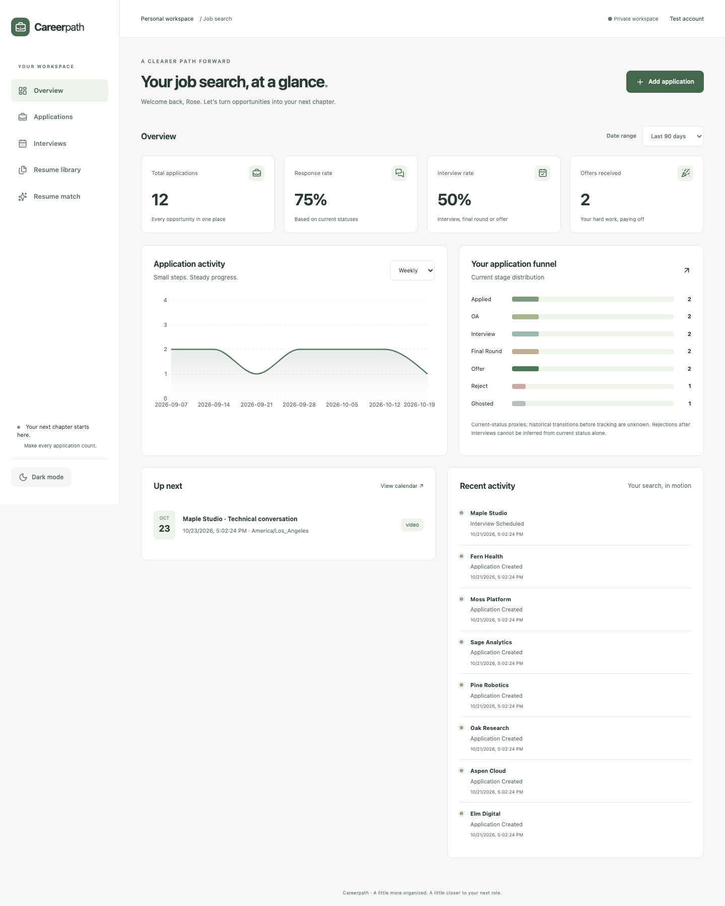
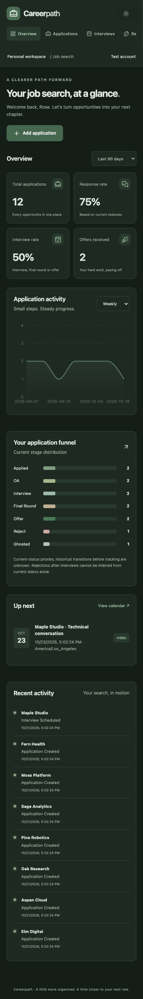
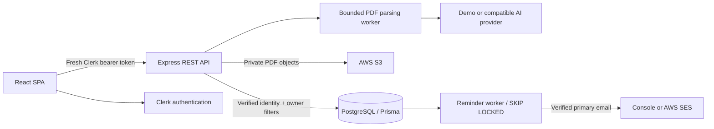

# Interview Tracker · Careerpath

A full-stack job-search workspace for organizing applications, preparing for interviews, and understanding recruiting progress. Built with React, TypeScript, Express, PostgreSQL, Prisma, Clerk and AWS integrations.

The upgrade preserves the existing application's data model and resume object keys. It adds validated, user-scoped APIs, a responsive dashboard, structured activity history, interview scheduling, durable reminders, and evidence-linked resume matching.

## Features

- **Dashboard:** date filters, totals for all seven statuses, weekly/monthly trends, current-stage distribution, explicitly labeled status-based response/interview rate proxies, upcoming interviews and persisted recent activity. Statistics come from the signed-in user's database records.
- **Applications:** create, edit, detail and delete; company/role search; location/status/date filters; sorting; bounded server pagination; notes, salary, HTTP(S) job links, resume selection and follow-up dates.
- **CSV:** transactional imports of up to 500 rows and filtered exports of up to 10,000 rows; invalid batches fail without partial imports; formula-leading export cells are escaped.
- **Resume library:** named PDF versions, 5 MB limit, PDF signature validation, private S3 objects, one-minute presigned downloads and ownership checks. Legacy object keys/URLs remain in the database; legacy URLs are no longer returned by list endpoints.
- **Resume match:** select a stored PDF, paste a job description, save and delete analysis history. The default **demo** is a local keyword comparison, clearly labeled as not AI. An optional OpenAI-compatible provider adds evidence-linked coaching. Matching percentages are heuristics, never ATS scores or hiring predictions.
- **Interview rounds:** UTC timestamps plus IANA zones, interview type, notes, status, monthly calendar, configurable reminder lead times, and completion events.
- **Reminders:** PostgreSQL-backed worker with transactionally created jobs, unique deduplication keys, concurrent claims with `FOR UPDATE SKIP LOCKED`, leases, retry backoff and visible delivery status. Console mode does not send email; SES sends only to the account's verified primary Clerk email.
- **UI:** reusable dialogs, native focus handling, labeled inputs, responsive navigation, light/dark mode, toast feedback, skeletons, actionable empty/error states and delete confirmation.

## Screenshots

Screenshots are generated against isolated browser-test records, not private user data.




## Stack and architecture

React 19 + Vite + TypeScript, React Router, TanStack Query, Axios, Tailwind CSS 4, Recharts and Lucide. Express 5 + TypeScript, Zod, Prisma 5 + PostgreSQL, Clerk, AWS SDK v3 S3/SES, and a standalone reminder worker. Vitest, Testing Library, Supertest, Playwright and GitHub Actions cover quality checks.



`client/src/pages` owns page workflows, `components` owns reusable views/forms, `hooks/useApi` retrieves a fresh Clerk token for each request, and TanStack Query caches data under keys containing the user ID. Pages are loaded on demand and chart/auth dependencies are separate production chunks.

`server/src/routes` handles HTTP boundaries, `services` owns application transactions and matching, `controllers` implements dashboard/storage operations, `lib` owns validation/errors, and `jobs` contains reminder delivery. `createApp` is separate from the server listener for integration testing. Test authentication injection is rejected outside `NODE_ENV=test`.

### Database relationships

| Model          | Purpose                                                                                               |
| -------------- | ----------------------------------------------------------------------------------------------------- |
| User           | Clerk ID as primary key; optional legacy email retained                                               |
| JobApplication | Owner, opportunity details, current status, optional resume and follow-up date                        |
| Resume         | Owner, preserved S3 object key/legacy URL, name, description, version and optional file metadata      |
| Activity       | Structured kind and JSON transition metadata tied to an application                                   |
| Interview      | Multiple rounds per application; UTC instant, IANA zone, notes/type/status                            |
| Reminder       | Durable due time, unique dedupe key, attempts, lease, delivery state and receipt                      |
| Analysis       | Owner/resume, job description, mode, result and creation date; incomplete attempts count toward quota |

Owner/date and owner/status indexes support scoped lists. Application deletion cascades dependent timeline/rounds/reminders. Resume deletion clears application selection and deletes associated analyses. The migration adds tables/nullable columns/defaults without deleting existing records or object keys.

## Local setup

Use Node.js **22.13+** (Node 22 LTS recommended), npm and PostgreSQL 16+. A Clerk development application is required for interactive sign-in. AWS is needed only for resume storage; AI and email default to demo/console.

```sh
npm ci
cp server/.env.example server/.env
cp client/.env.example client/.env
npm run db:generate
```

Populate the files locally. Never paste secret keys in chat or commit them. The old tracked frontend `.env` is removed from version control by this upgrade; use the example file. Rotate any previously exposed AWS/Clerk credentials through their dashboards.

| Variable                                  | Purpose                                                                                   |
| ----------------------------------------- | ----------------------------------------------------------------------------------------- |
| DATABASE_URL                              | PostgreSQL connection URL; use TLS for a managed database                                 |
| PORT                                      | API port, default 5001                                                                    |
| CLIENT_ORIGIN                             | Exact frontend origin; HTTPS required in production                                       |
| CLERK_PUBLISHABLE_KEY / CLERK_SECRET_KEY  | Backend Clerk configuration                                                               |
| VITE_CLERK_PUBLISHABLE_KEY                | Public frontend Clerk key for the same instance                                           |
| VITE_API_URL                              | API base URL including `/api`; compiled into the frontend build                           |
| AWS_REGION / AWS_BUCKET_NAME              | Private resume bucket configuration                                                       |
| AWS_ACCESS_KEY_ID / AWS_SECRET_ACCESS_KEY | Optional local standard SDK credentials; prefer a workload IAM role in production         |
| AWS_ACCESS_KEY / AWS_SECRET_KEY           | Legacy S3-only aliases retained for compatibility                                         |
| AI_MODE                                   | `demo` (default) or `openai-compatible`                                                   |
| AI_BASE_URL / AI_MODEL / AI_API_KEY       | Optional backend provider endpoint, model and secret; choose a model supporting JSON mode |
| EMAIL_PROVIDER                            | `console` (default) or `ses`                                                              |
| EMAIL_FROM                                | Required verified sender for SES                                                          |

For a **new, empty database only**, apply the migration chain:

```sh
npm run db:migrate
```

For an existing database, follow [the migration runbook](docs/DEPLOYMENT.md#existing-database-upgrade) first. Do not run reset, force-push or replay unapplied historical migrations against existing resume data.

Start the frontend/API and, separately, the worker:

```sh
npm run dev
npm run worker -w server
```

Open `http://localhost:5173`. API liveness is `http://localhost:5001/health`; `/ready` checks the database. Reminder polling occurs every 15 seconds. In console mode jobs are marked `previewed` and no email is sent or personal message content logged.

### External services

**Clerk:** configure the development frontend origin/redirects and matching publishable/secret keys. The API verifies session tokens with an authorized-origin allowlist before every `/api` route. No custom JWT secret is used.

**S3:** enable Block Public Access and default encryption. Give the API role only `s3:PutObject`, `s3:GetObject`, and `s3:DeleteObject` for the configured bucket's resume objects, including legacy keys. Do not rename legacy objects. Bucket permissions are an external setup step; deploying code alone does not make old public objects private. Existing objects must be audited before enabling a production demo. See [privacy and storage operations](docs/SECURITY.md).

**AI:** demo requires no API key and does not contact a model provider. Real mode sends extracted resume text (up to 20 PDF pages / 40,000 characters) and the job description to the configured endpoint after user consent. Requests have a timeout, a per-user rate limit and a database-serialized quota of 10 attempts per rolling day. Outputs pass Zod and exact evidence checks; unverified factual claims are not accepted as verified experience. Coaching still needs human review. JSON mode is used for cross-provider compatibility, then validated server-side; see [official JSON-mode guidance](https://developers.openai.com/api/docs/guides/structured-outputs). Requests set `store:false`; separately review the provider's retention policy.

**SES:** verify a sender/domain, configure the worker's IAM role with `ses:SendEmail`, and verify recipients while SES is in sandbox. Console mode stays functional without SES. No live email or paid model requests are part of the automated tests.

## API conventions

Bearer authentication is required for `/api/*`. Errors use `{message, errors?: [{field,message}]}` with appropriate HTTP status; successful creates use 201 and deletes 204. List responses use `{items,total,page,pageSize,totalPages}` for applications. Maximum page size is 100. Resume lists show at most 200 versions, interview lists at most 500 rounds, analysis history at most 50 attempts, and per-application timeline at most 200 events.

| Endpoint                                        | Methods / behavior                                                      |
| ----------------------------------------------- | ----------------------------------------------------------------------- |
| `/api/applications`                             | GET paginated list; POST create                                         |
| `/api/applications/:id`                         | GET detail with timeline/rounds; PUT or PATCH partial update; DELETE    |
| `/api/applications/import`                      | POST `{csv}`; atomic validation/import                                  |
| `/api/applications/export`                      | GET filtered CSV                                                        |
| `/api/applications/:id/interviews`              | POST round and optional reminder                                        |
| `/api/applications/:id/interviews/:interviewId` | PATCH round status/notes                                                |
| `/api/dashboard`                                | GET scoped aggregates; `from`/`to` date filters                         |
| `/api/interviews`                               | GET owned calendar rounds                                               |
| `/api/reminders`                                | GET owned delivery statuses                                             |
| `/api/resumes`                                  | GET metadata; POST multipart `resume`, `name`, `description`, `version` |
| `/api/resumes/:id/download`                     | GET one-minute presigned private URL                                    |
| `/api/resumes/:id`                              | DELETE object and record                                                |
| `/api/analyses/config`                          | GET mode, provider origin/model and daily quota                         |
| `/api/analyses`                                 | GET history; POST `{resumeId,jobDescription,consent}`                   |
| `/api/analyses/:id`                             | DELETE history                                                          |

Application list/export filters: `search`, `status`, `location`, `from`, `to`, `sort`, `direction`, `page`, `pageSize`. Sort fields are allowlisted. Status strings remain compatible with existing data: Applied, OA, Interview, Final Round, Offer, Reject, Ghosted.

CSV headers: `company,role,status,appliedDate,location,salary,jobLink,notes`. Company, role and appliedDate are required; status defaults to Applied. Dates must be ISO dates/timestamps. Importing the same file twice creates duplicates; preview/check it before submitting. Escaped formula-leading cells are exported as literal spreadsheet text.

## Testing and checks

```sh
npm run check             # lint, client/server types, unit/component tests, both builds
npx playwright install chromium
npm run test:full         # disposable PostgreSQL, migration preservation, API and browser tests
npm run test:db           # same isolated DB checks without browser tests
npm audit
```

The test runner ignores your DATABASE_URL, starts PostgreSQL on an unused local port in a temporary directory, and creates separate test databases. It checks the entire fresh migration chain and seeds a legacy resume before applying the additive migration to assert preservation. PostgreSQL binaries are a development-only dependency. In constrained environments, allow local child processes and loopback ports; no Docker daemon is required.

API tests use real PostgreSQL and inject a test identity; S3/Clerk delivery lookups are mocked. Browser tests run the real API, database and UI with a test-only Clerk adapter selected exclusively by Vite's `e2e` mode. They exercise application create/detail/status/delete, interview creation, search, CSV export, responsive navigation and theme. They do **not** verify Clerk's hosted login, real bucket policies, SES delivery or paid AI outputs. Never deploy an `e2e` frontend build or the test server.

## Deployment and operations

Docker targets for frontend/API, a separate worker process, local Compose and CI are included. CI runs checks, disposable database/browser tests and container builds. It **does not deploy or migrate production automatically**. See [deployment, migrations and rollback](docs/DEPLOYMENT.md) for the suggested architecture and approval gates.

## Limitations and next improvements

- No production deployment or usage metrics are claimed. Hosted authentication, storage policy, managed DB connectivity, SES delivery and live model output need a staging acceptance pass after external configuration.
- Rates are **current-status proxies**, not reconstructed historical funnels. A rejection after an old interview cannot be inferred. New transitions are recorded in the timeline, but historical records are not fabricated.
- Calendar dates use the device zone; detail pages retain each round's IANA zone. Repeated/skipped daylight-saving times should be checked after scheduling. Round status/notes can be updated; to change the time, cancel the round and create its replacement.
- SES has no exactly-once send API. Explicit throttling/service rejection retries with exponential backoff (up to five attempts); ambiguous or expired in-flight deliveries become `uncertain` for manual reconciliation instead of automatic duplication.
- Local PDF extraction has a worker memory/time budget and requires readable text. OCR, antivirus scanning, encrypted PDF support and very large libraries are future work.
- Global API rate limits use an in-memory IP store; deploy one API replica behind a controlled proxy until a shared limiter is configured. Analysis usage and reminder coordination are durable across processes.
- Optional Kanban, account self-service deletion, automatic history retention, structured tracing, calendar sync, S3 inventory reconciliation and expanded accessibility/browser coverage remain future work.
- The existing Clerk React v5 dependency is retained for compatibility but is deprecated upstream; migrate to its successor in a separately tested change.

## Portfolio bullets

- Built a full-stack React and TypeScript job-search platform with user-scoped Express APIs, PostgreSQL/Prisma models, validated application management, server-side filtering/pagination, CSV workflows and interactive analytics.
- Integrated private S3 resume storage and configurable resume matching with bounded PDF extraction, schema-validated results, evidence checks, usage quotas and a clearly labeled local demonstration mode.
- Implemented interview scheduling, structured activity history and a PostgreSQL-backed reminder worker with concurrent job claims, retry backoff and duplicate-delivery safeguards; added API, component and Playwright tests plus CI/container build configuration.

Original project by Rose Wei. See [audit](docs/AUDIT.md), [progress checklist](docs/PROGRESS.md), [security notes](docs/SECURITY.md) and [walkthrough](docs/WALKTHROUGH.md).
